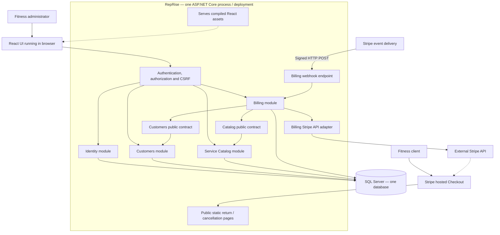
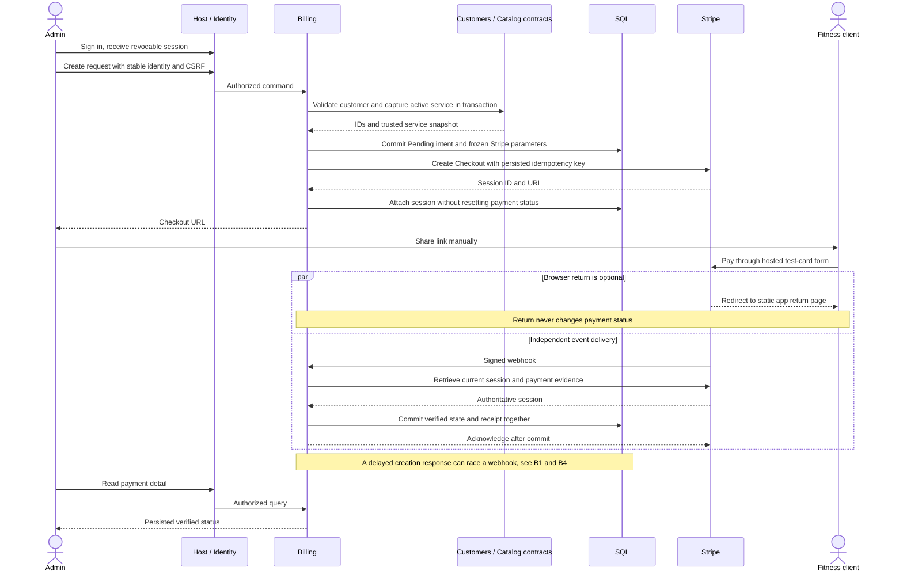

# RepRise — modular monolith design
**Status:** Proposed design, ready for review. No feature implementation or runtime verification.
**Scope authority:** [Requirements](../requirements.md) and [eight stories](../stories/README.md).

## Stack and deployment
React with TypeScript provides the admin UI. C# / ASP.NET Core Web API hosts four business modules and serves the compiled React assets from the same origin. SQL Server (Azure SQL when hosted) stores data using Entity Framework Core code-first migrations. ASP.NET Core Identity manages staff credentials and roles. The Stripe .NET SDK integrates hosted Checkout in test mode.

One application is built and deployed as one unit. The webhook is an HTTP endpoint **inside Billing in that application**, not a separately deployed Azure Function. Azure App Service is the proposed eventual host. No infrastructure has been provisioned. Pin compatible supported .NET, EF Core, frontend, Stripe SDK and Stripe API versions when implementation begins; commit dependency locks and migrations.

Microsoft describes how a single deployed application can maintain internal logical boundaries: [application architecture guidance](https://learn.microsoft.com/en-us/dotnet/architecture/modern-web-apps-azure/common-web-application-architectures). The module choices below are RepRise design decisions.

## System diagram

## Module ownership
| Module | Responsibility | Owned schema / records | Stories |
| --- | --- | --- | --- |
| Identity | Provisioned staff, login, logout, role and session validation | identity: Identity tables, AdminSession | US-01; guards all admin stories |
| Customers | Create, read and update fitness clients | customers: Customer | US-02 |
| Service Catalog | Fixed USD pricing, edits and deactivation | catalog: Service | US-03 |
| Billing | Price snapshots, Checkout creation, verified notifications, payment state and views | billing: PaymentRequest, WebhookEvent | US-04–US-08 |

Webhook handling is part of Billing. Payment list/detail is part of Billing, not a reporting module. A Customer is a person being billed, not an authentication User. A Service describes a single training session or assessment; it is not a recurring Plan.

## Boundary and dependency rules
1. Each module owns its domain types, use cases, validation, repository interfaces and endpoint registration. Internal types stay internal.
2. Billing may call only Customers.Contracts and ServiceCatalog.Contracts. Customers and Catalog never depend on Billing. Identity supplies the authenticated actor through host middleware; other modules do not read its tables.
3. Contracts return immutable DTOs or explicit results, never EF entities, navigation properties or IQueryable. Only each owner can mutate its records.
4. Infrastructure implements module repository ports. For this small monolith, one internal EF DbContext and transaction coordinator map the four schemas. No endpoint or domain/application module can access that context directly.
5. This shared persistence implementation is a deliberate coupling: it supports a single database transaction for request validation/snapshot capture and for webhook receipt/payment updates. It does not grant modules access to one another's repositories. Architecture checks must enforce these references.
6. In-process contract calls share the scoped transaction when required. No HTTP calls between modules, message broker, distributed transaction, separate webhook worker or microservice deployment.
7. No SQL transaction spans a Stripe network call. Persist intent first, call Stripe, then persist the result. A Billing-owned reconciliation task runs in the same host and uses database leases.
8. The host is the composition root. Only it and infrastructure can reference module implementations for wiring. Shared primitives are limited to IDs, clock, actor, transaction and result abstractions; there is no shared business-model library.

Proposed projects (documentation only): Host, Modules.Identity, Modules.Customers, Modules.Customers.Contracts, Modules.ServiceCatalog, Modules.ServiceCatalog.Contracts, Modules.Billing, Infrastructure, and tests. React lives under web/. This is a project layout recommendation, not an existing solution.

## End-to-end purchase

## Individual diagrams
[Review all 16 diagrams separately](diagrams/README.md). Each has a standalone .mmd file and a Markdown preview.

## Read the implementation workflows
- [Identity](identity.md): provisioning, login, authorization and session revocation.
- [Customers](customers.md): validation, duplicate-email policy and updates.
- [Service Catalog](service-catalog.md): price validation, deactivation and snapshot boundary.
- [Billing](billing.md): request creation, hosted payment, webhook races, state machine, outage recovery and views.
- [Data model](data-model.md): fields, relationships, constraints and migrations.
- [Coverage and verification](coverage.md): all 36 acceptance criteria, five FRs, three NFRs and security/operational checks.

## Scope lock
One company; fictional data; test mode; USD; cards; one service at quantity one; manually shared links; provisioned admins. No subscriptions, recurring memberships, invoices, refunds, reporting/exports, taxes, discounts, multiple currencies, customer accounts, automated email, multi-tenancy, scheduling, attendance, workouts or health data. Address is unnecessary for this MVP. Stripe-hosted payment data is not copied into the application.

Design completeness means every current acceptance criterion has an owner, workflow and verification plan. It does not mean the software has passed those tests. Requirements/mentor review, implementation, measurement and production readiness remain separate work.
