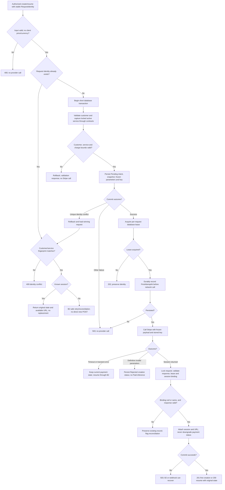
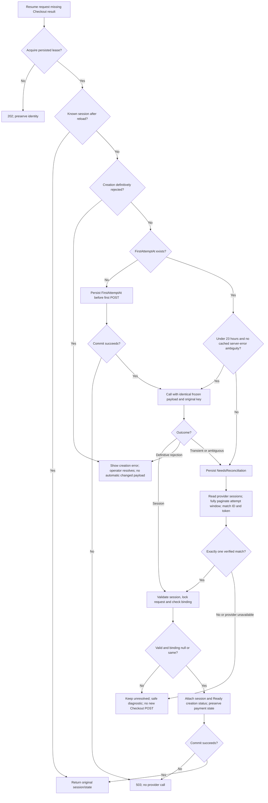
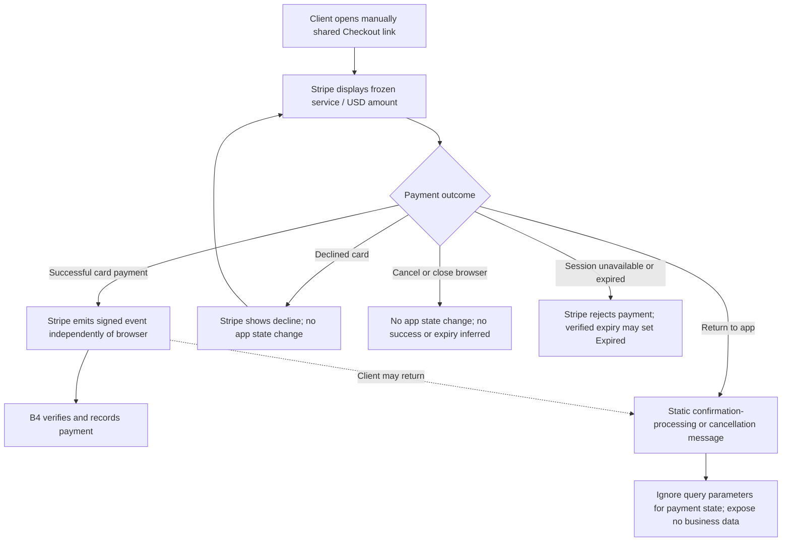
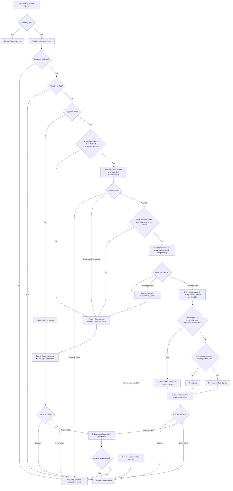
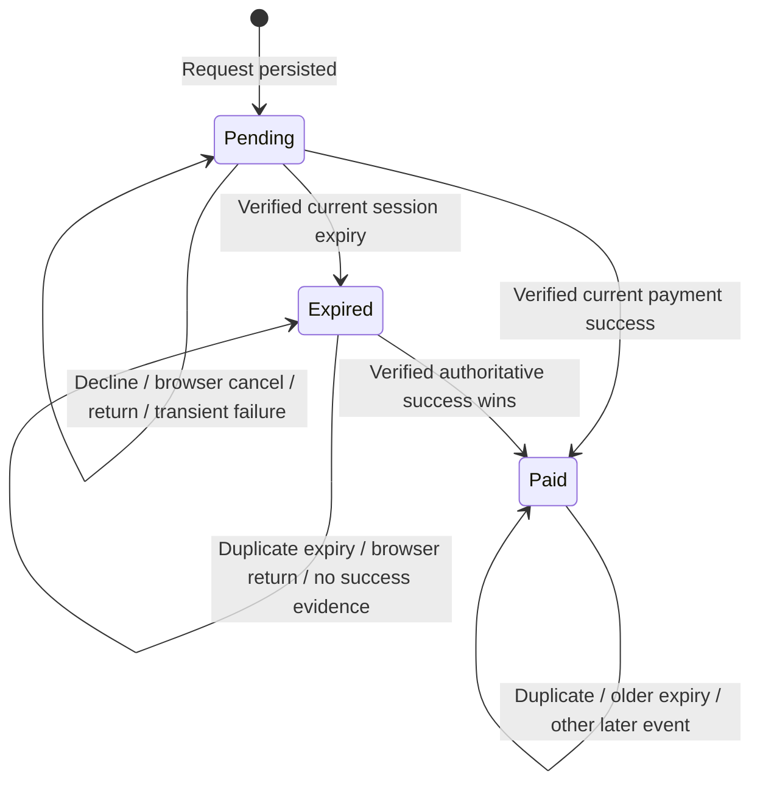
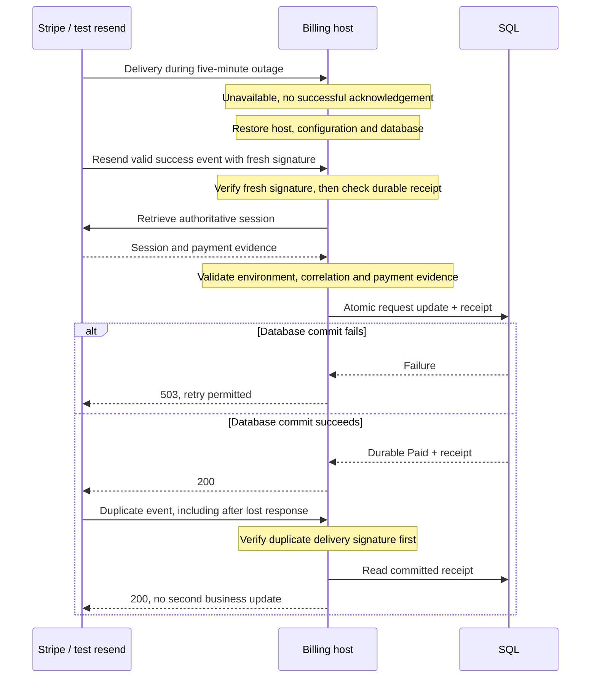
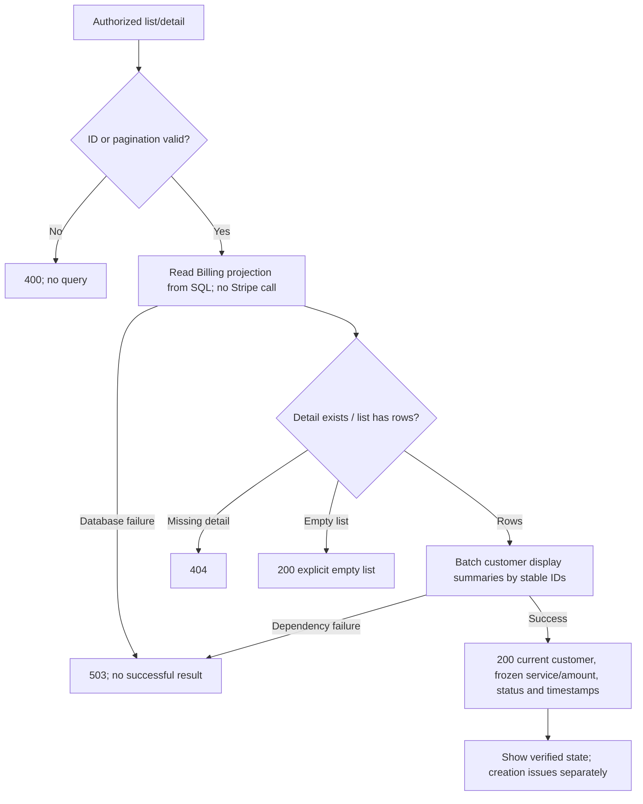

# Billing module
[Architecture index](README.md) · **Owner:** US-04 through US-08, FR-04/05

Owns a PaymentRequest aggregate and WebhookEvent receipts. One request is one purchase of one service, quantity one. A separate Payment table is unnecessary for the MVP: the request stores the single successful provider payment reference. Do not create Subscription, Plan, Membership, Invoice or Refund models.

## API and public boundary
| Route | Access | Result |
| --- | --- | --- |
| POST /api/billing/payment-requests | Admin + CSRF | Create/resume using RequestIdentity, CustomerId, ServiceId |
| GET /api/billing/payment-requests | Admin | Paginated payment summaries |
| GET /api/billing/payment-requests/{id} | Admin | Persisted detail and available Checkout URL |
| POST /webhooks/stripe | Stripe signature; no cookie/CSRF | Process selected snapshot events |
| GET /checkout/return and /checkout/cancel | Public static pages | Generic message, no business data or state mutation |

Reject client-supplied price/currency fields. The React form generates a random RequestIdentity once per intentional purchase and retains it across retries and reloads. Disable double-submit as a convenience; database constraints supply correctness. Same identity plus different customer/service returns 409. Admins may access all company requests; identity reuse is checked globally rather than generating a new key per staff member.

Common responses: 400 validation, 401/403 authorization, 404 missing record, 409 conflict, 202 still creating/reconciling, 503 temporary dependency failure. Responses carry RequestId when already allocated and a safe error code; never claim Paid on error. No stack traces or provider secrets.

## B1 — Capture and create Checkout

Create the request and capture the service in one transaction. A unique RequestIdentity constraint handles racing submissions: the loser rolls back, reloads the winner and compares the fingerprint. Lock ordering is customer, service, then payment request for new creation; webhook transactions touch only Billing.

The persisted Stripe payload uses mode=payment, card payment methods, quantity=1, inline price_data with the frozen USD amount and service name, fixed return/cancel URLs, client_reference_id=RequestId, and metadata RequestId plus a random correlation token. Disable promotion codes, automatic tax and adjustable quantity. No customer email is required in this payload; Stripe handles payment entry. Any provider parameters used must be frozen before the first call.

Record FirstAttemptAt before calling Stripe. A short database lease serializes normal attempts; a 60-second lease with owner token is renewed while active and expires after a crashed host. Lease fencing prevents stale workers overwriting newer results. Stripe idempotency still protects overlapping calls after lease expiry. Attaching a response must never reset an already Paid/Expired status. If a webhook bound the same session first, attaching is a no-op; a different session is quarantined for operator review.

## B2 — Ambiguous creation and recovery
Stripe API v1 may retain the first response including an error, and keys can be removed after 24 hours. Therefore indefinite resubmission is unsafe. See [Stripe idempotency semantics](https://docs.stripe.com/api/idempotent_requests).

Use a Billing in-process recovery task every 30 seconds, with persisted leases and bounded exponential backoff (1, 2, 4 seconds for immediate transient retries; never endless retries on a web request). Reconciliation uses read-only Stripe API calls through the same configured test account and validates the entire frozen purchase. Never log the correlation token. No raw Checkout payloads are stored in logs.

Zero matches does not prove a failed creation when provider history/visibility is incomplete; multiple matches indicate an invariant breach. Keep these requests blocked and surface an admin-safe “creation needs reconciliation” message. The operator checks Stripe test-mode records and request IDs; resolve only by binding a proven matching session or recording a confirmed failure with evidence. Do not mint a fresh provider key automatically. A new intentional purchase uses a new RequestIdentity; the UI must not suggest a new purchase as a timeout retry.

A definitively rejected provider payload remains on the original request with a safe creation error. Correct configuration before resuming; never mutate parameters for an identity already sent. If purchase terms must change, the original must be conclusively nonpayable before a distinct purchase is created. This operational exception does not add a refund or payment-management feature.

## B3 — Hosted payment and browser return

Clients need no app login. Checkout links grant no admin permissions. Return/cancel pages expose no customer details, request history or privileged API tokens. Return URLs do not carry business data. The payment view remains Pending unless a verified event has already changed it; a browser return must never overwrite a legitimately Paid result. No appointment, membership entitlement or email is produced.

## B4 — Webhook verification and atomic processing
Subscribe to snapshot events checkout.session.completed and checkout.session.expired in the configured test account. Cards only; asynchronous payment methods are disabled, so adding them later requires new event handling and acceptance tests.

Verify the Stripe-Signature using the SDK against the original raw request bytes, with its normal timestamp tolerance and a dedicated endpoint secret. Keep the host clock synchronized. Stripe documents raw-body verification, possible duplicates and unordered delivery in its [webhook guide](https://docs.stripe.com/webhooks).

Correlation rules:
- Require the local RequestId, persisted correlation token, current session metadata and frozen amount/currency to agree. Validate event/session livemode=false and use only the configured account's credentials. Connect/multi-account events are not supported.
- A stored CheckoutSessionId must equal the incoming/retrieved ID. If it is null because the webhook won the race, bind only after all correlation checks succeed against the already committed request.
- For Paid, require mode=payment, payment_status=paid, successful PaymentIntent status, matching PaymentIntent currency/received amount, and the session's reference to that intent. Enforce unique session and payment-intent IDs in SQL.
- PaidAt is the first local UTC verified-confirmation time, not a claimed bank settlement timestamp. Preserve it on all later deliveries.
- Current Stripe state takes precedence over an older event snapshot. Pending or declined evidence never downgrades a paid request. Unknown or mismatched events cannot bind a session.
- Unsupported signed events receive an Ignored receipt. A known supported event that cannot be trusted receives a Quarantined receipt with a reason code and safe IDs only. These are deliberately acknowledged after durable recording to avoid poison-event retry loops; operator investigation is required.
- Transient provider/database failures receive 503 without a processed receipt. An operator reprocesses a quarantined event only after resolving the cause, using the same validation pipeline and an explicitly reopened receipt; payment guards still apply.

Concurrency: lock the PaymentRequest row before state changes; insert a uniquely indexed account/environment/EventId receipt in the same transaction. On a duplicate-key race, roll back and read the committed receipt: acknowledge only if it exists. Distinct event IDs for the same session serialize on the request and produce one Paid transition. Bound deadlock/row-version retries; return 503 when exhausted. Never mark a receipt Processed before the payment update is durable.

## B5 — Payment state machine
CreationStatus (Creating, Ready, NeedsReconciliation, Rejected) describes link creation and is separate from payment Status.

No transition out of Paid in this MVP. Refunds are future scope. A delayed expiry event must retrieve current state before acting. Expired requests are retained; retrying their original identity does not create another session.

## B6 — Outage and acknowledgement recovery

Recovery target: within 60 seconds of receipt after restoration, with dependencies available, both replay deliveries yield one payment row and one Paid transition. Use Stripe resend or a fresh valid signed fixture; a five-minute-old raw signature is not an acceptable replay test. This design uses synchronous durable handling, not a queue. Provider calls have timeouts; failure to finish returns non-2xx for later delivery.

## B7 — Admin payment queries

Default page size 25, maximum 100; order CreatedAt descending then Id descending. Use bounded projections and a matching index; no per-row Stripe calls or customer queries. Detail includes RequestId, CustomerId, ServiceId, snapshot, currency, status, available session/intent IDs, CreatedAt, PaidAt and creation status; Checkout URL only for authorized staff. A customer edit can change display name, never customer association. Service/price always come from the snapshot. Do not include raw events, credentials, correlation tokens or provider payloads in DTOs.
