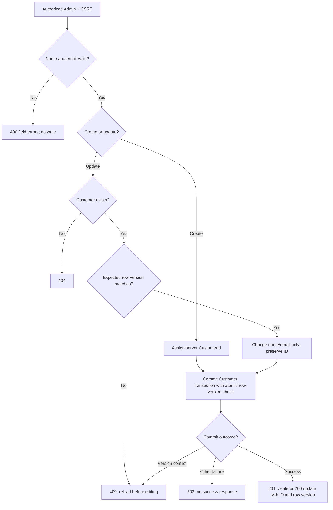
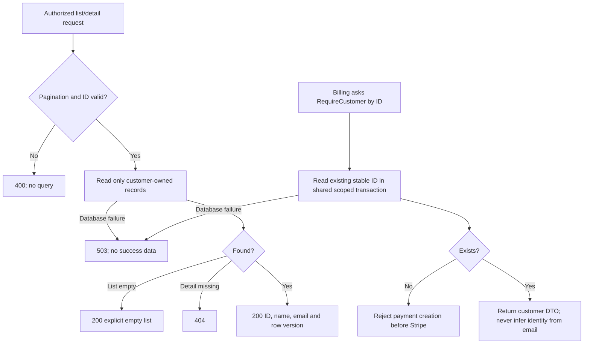

# Customers module
[Architecture index](README.md) · **Owner:** US-02

Owns Customer only. Identity users and Stripe customers are separate concepts; the MVP does not need a Stripe Customer object.

## Endpoints and contract
- GET /api/customers and GET /api/customers/{id}: paginated list and detail.
- POST /api/customers: create with name and email.
- PUT /api/customers/{id}: update with name, email and expected row version.
- No delete endpoint.
- Customers.Contracts exposes RequireCustomer(id, transaction) and GetSummaries(ids). Billing receives stable IDs and display data; it cannot mutate customers.

All endpoints use the [Identity guard](identity.md). Trim outer whitespace; name must be nonblank and at most 200 characters; email must pass server-side email syntax validation and be at most 254 characters. Syntax validation is not proof of mailbox ownership. Duplicate email addresses are explicitly allowed. No email uniqueness constraint or email-based association.

## Write workflow

A create response lost after commit can be resolved by reading the list; automatically repeating customer creation is not allowed because duplicate emails are valid and cannot safely deduplicate records. Checkout retry guarantees belong specifically to Billing.

## Read and association workflow

Use page sizes 25 by default, maximum 100, deterministic ID ordering. GetSummaries takes only the IDs on the payment page and executes one batch query. Customer edits change the current name displayed in admin lists; they do not change PaymentRequest.CustomerId or original service/price snapshots. No customer deletion or cascade into payments is permitted.

Verification includes two distinct customer IDs with the same email, invalid writes with unchanged row counts, stale-update conflicts, and edits after a payment exists.
