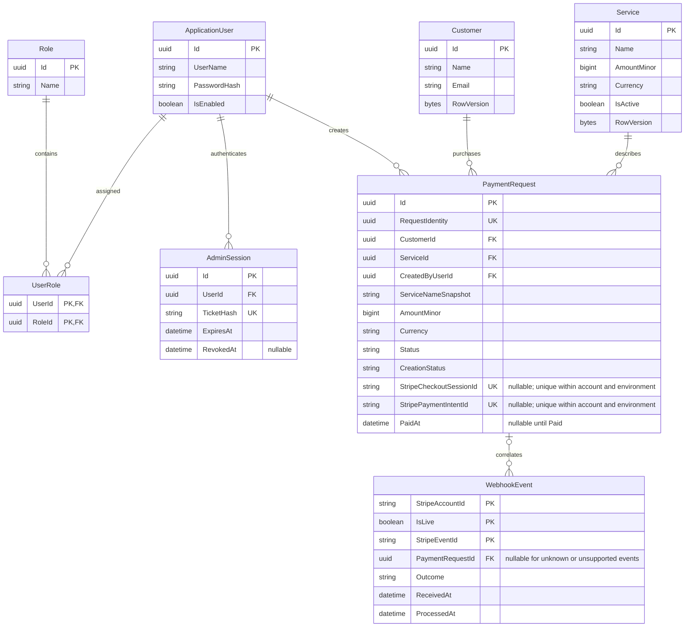

# RepRise data model
[Architecture index](README.md) · Proposed EF Core code-first relational model

## Relationships

Diagram shows core fields; the complete persistence decisions are below. All times are UTC datetimeoffset, IDs are server-generated GUIDs unless specifically supplied as RequestIdentity, and nullable fields are marked ?. WebhookEvent's actual key includes account and environment. Foreign keys use NO ACTION / restricted deletion; no cascades into business history.

## Identity schema
Use ASP.NET Core Identity's standard user/role tables and supporting claim/login/token tables as required by the library. User and Role are not custom password/security implementations.

| Record | Fields and rules |
| --- | --- |
| ApplicationUser | Id; UserName; normalized unique username; PasswordHash; SecurityStamp; lockout fields; IsEnabled; standard Identity concurrency fields. Only provisioned staff. No customer relationship required. |
| Role | Id; Name; normalized unique name. Seed the Admin role without seeding credentials. |
| UserRole | Composite PK UserId + RoleId; FKs to Identity records. |
| AdminSession | Id; UserId FK; unique TicketHash; SecurityStampAtIssue; CreatedAt; ExpiresAt; RevokedAt?; RowVersion. Never persist the raw bearer ticket. Index UserId and expiry. |

## Customers schema
Customer: Id PK; Name nvarchar(200); Email nvarchar(254); CreatedAt; UpdatedAt; RowVersion SQL rowversion. All required. No unique email index. Validation is described in [Customers](customers.md).

## Catalog schema
Service: Id PK; Name nvarchar(200); AmountMinor bigint > 0; Currency char(3) constrained to USD; IsActive bit; CreatedAt; UpdatedAt; RowVersion. All required. No floating-point storage, recurring interval, scheduling or membership fields.

## Billing schema
| PaymentRequest field | Rule |
| --- | --- |
| Id | PK; internal stable purchase identity |
| RequestIdentity | Required unique GUID from client; survives retries |
| InputFingerprint | Required canonical customer/service IDs used to reject conflicting identity reuse |
| CustomerId / ServiceId / CreatedByUserId | Required restricted FKs; access through owner contracts |
| ServiceNameSnapshot | Required nvarchar(200), immutable after creation |
| ServiceVersionSnapshot | Required captured catalog row version |
| AmountMinor / Currency | Required immutable positive bigint and USD |
| Status | Required Pending, Paid or Expired |
| CreationStatus | Required Creating, Ready, NeedsReconciliation or Rejected |
| StripeAccountId / IsLive | Required configured account identifier; IsLive=false in MVP |
| StripeIdempotencyKey | Required unique random key, maximum 255 characters; no personal data |
| CorrelationToken | Required random correlation value; never log or expose in DTOs; not a replacement for webhook signature verification |
| FrozenCheckoutParameters | Required restricted JSON of non-card, non-secret creation fields; immutable after first attempt |
| StripeCheckoutSessionId? | Unique filtered index on nonnull account/environment/session |
| StripePaymentIntentId? | Unique filtered index on nonnull account/environment/intent |
| CheckoutUrl? | Returned hosted URL; only authorized DTOs, exclude logs |
| CreatedAt / UpdatedAt | Required UTC timestamps |
| FirstAttemptAt? / LastAttemptAt? / NextAttemptAt? | Durable retry scheduling and idempotency-window guard |
| LeaseOwner? / LeaseExpiresAt? | Database lease/fencing for creation and reconciliation |
| CreationErrorCode? | Sanitized bounded enum/code, not raw exception text |
| PaidAt? | First verified confirmation time; required when Paid, immutable thereafter |
| RowVersion | Optimistic concurrency token in addition to transactional row locking |

PaymentRequest is both purchase intent and the one-time payment record. Repeated card attempts within one Checkout session do not create app payment rows. Constraint: Paid requires nonnull session ID, intent ID and PaidAt. Non-Paid requires PaidAt null. Creation response attachment must preserve status set by an earlier webhook.

WebhookEvent:
- Composite PK: StripeAccountId + IsLive + StripeEventId.
- EventType; StripeObjectId?; PaymentRequestId? restricted FK; ProviderEventCreatedAt; ReceivedAt; ProcessedAt; Outcome (Processed, Ignored, Quarantined); DiagnosticCode?.
- Nullable local request FK supports unknown requests and unsupported events. Never store an invalid foreign key merely because metadata supplied an ID.
- Persist only allowed identifier/type/timestamp fields, no raw event bodies, card details or credential material.
- Processed includes verified no-op deliveries; Quarantined identifies a permanent validation issue requiring investigation. Transient failures do not get a committed handled receipt.
- Index PaymentRequestId and ReceivedAt; retain receipts throughout MVP testing so old deliveries remain deduplicated. Any future purge policy must preserve the payment uniqueness and state guards.

Indexes: PaymentRequest(CreatedAt DESC, Id DESC) including list projection fields; CustomerId and ServiceId relationship indexes; unique request/session/intent indexes above; retry index on CreationStatus + NextAttemptAt. Avoid indexing full JSON, tokens or URLs unnecessarily.

## Transactions and migrations
One internal EF DbContext maps configurations into identity, customers, catalog and billing schemas. Repository ports enforce ownership. Cross-schema FKs provide integrity, not permission to bypass module contracts. A single controlled migration stream avoids competing schema changes; no automatic migrations from multiple running host instances.

Transaction boundaries:
1. A customer/service/Identity write commits within its owner's use case.
2. New payment request: validate selected customer, lock/capture active service, persist frozen snapshot and unique identity, commit; then call Stripe.
3. Attach Checkout response: lock request, check session binding and lease, preserve payment state, commit.
4. Webhook: lock request, recheck receipt/bindings, update state and insert receipt atomically. Quarantine/ignored receipts commit independently when no request update is valid.

Use bounded deadlock/concurrency retries; return a retryable error on exhaustion. Never fake a successful write when the database is unavailable. Integration tests must run on SQL Server because uniqueness filters, rowversion and locking are provider-specific.

## Why the proposed original models changed
| Proposed model | MVP decision |
| --- | --- |
| Customer | Keep; fitness client contact record |
| User / Role | Keep through ASP.NET Core Identity, plus UserRole and revocable AdminSession |
| Plan | Replace with Service for fixed one-time pricing |
| Subscription / Membership | Defer; recurring billing and access entitlements are outside scope |
| Address | Defer; not required by current stories |
| PaymentRequest / WebhookEvent | Add; necessary for purchase snapshots, provider correlation and safe event handling |

This model deliberately does not store card data or fitness health information.
