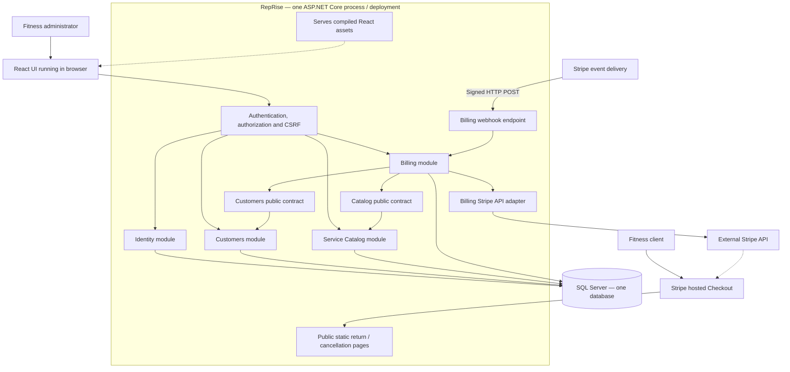

# System diagram

[Diagram index](README.md) | [Mermaid source](01-system-overview.mmd) | [SVG](rendered/01-system-overview.svg) | [PNG](rendered/01-system-overview.png) | [Full workflow context](../README.md)

