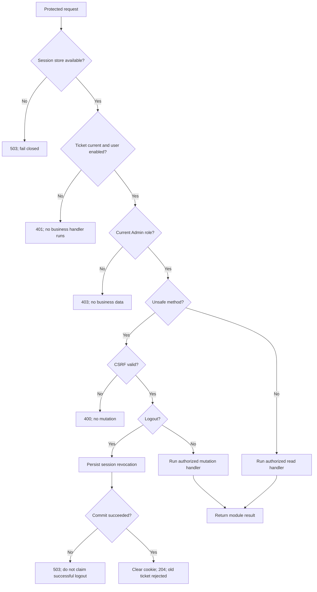

# Guard and logout workflow

[Diagram index](README.md) | [Mermaid source](04-authorization-and-logout.mmd) | [SVG](rendered/04-authorization-and-logout.svg) | [PNG](rendered/04-authorization-and-logout.png) | [Full workflow context](../identity.md)

