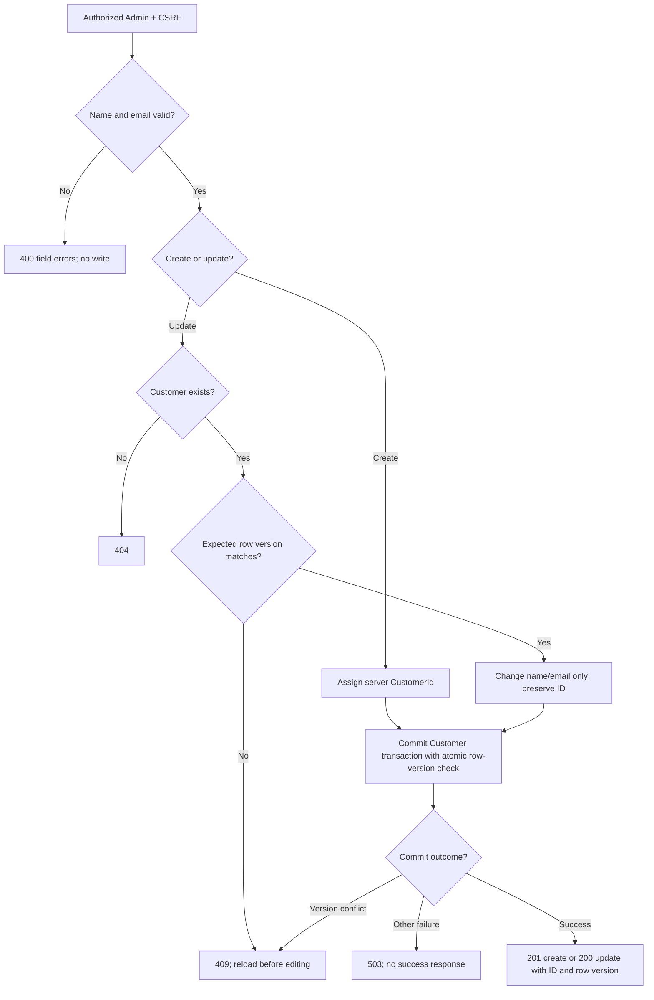

# Write workflow

[Diagram index](README.md) | [Mermaid source](05-customer-write.mmd) | [SVG](rendered/05-customer-write.svg) | [PNG](rendered/05-customer-write.png) | [Full workflow context](../customers.md)

