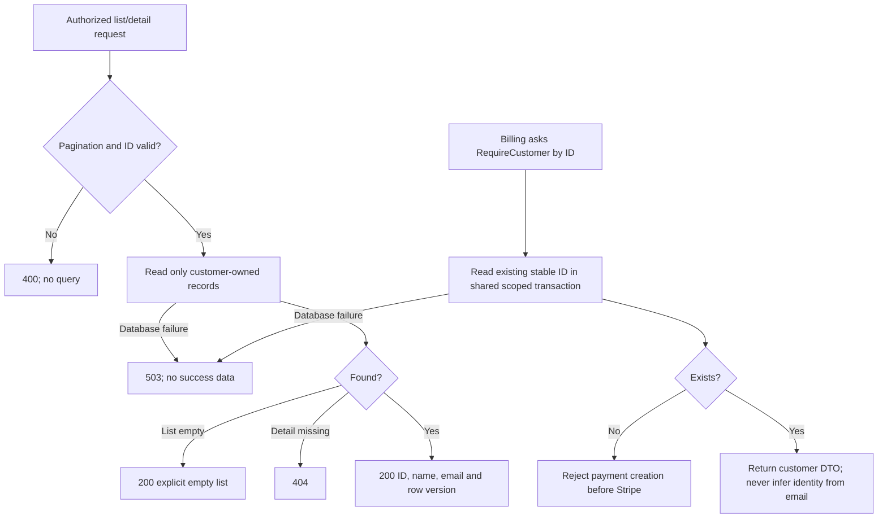

# Read and association workflow

[Diagram index](README.md) | [Mermaid source](06-customer-read-and-association.mmd) | [SVG](rendered/06-customer-read-and-association.svg) | [PNG](rendered/06-customer-read-and-association.png) | [Full workflow context](../customers.md)

