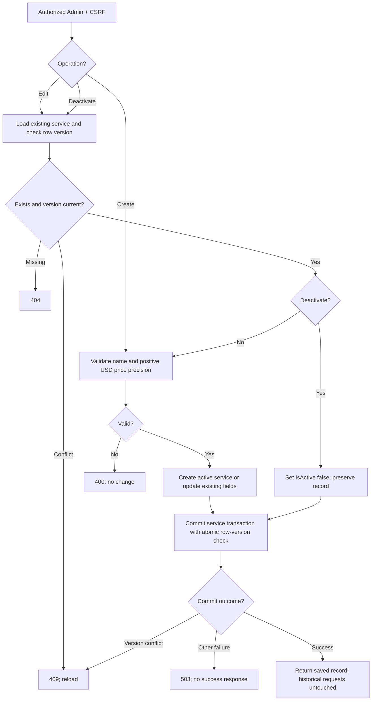

# Create/edit/deactivate workflow

[Diagram index](README.md) | [Mermaid source](07-service-management.mmd) | [SVG](rendered/07-service-management.svg) | [PNG](rendered/07-service-management.png) | [Full workflow context](../service-catalog.md)

