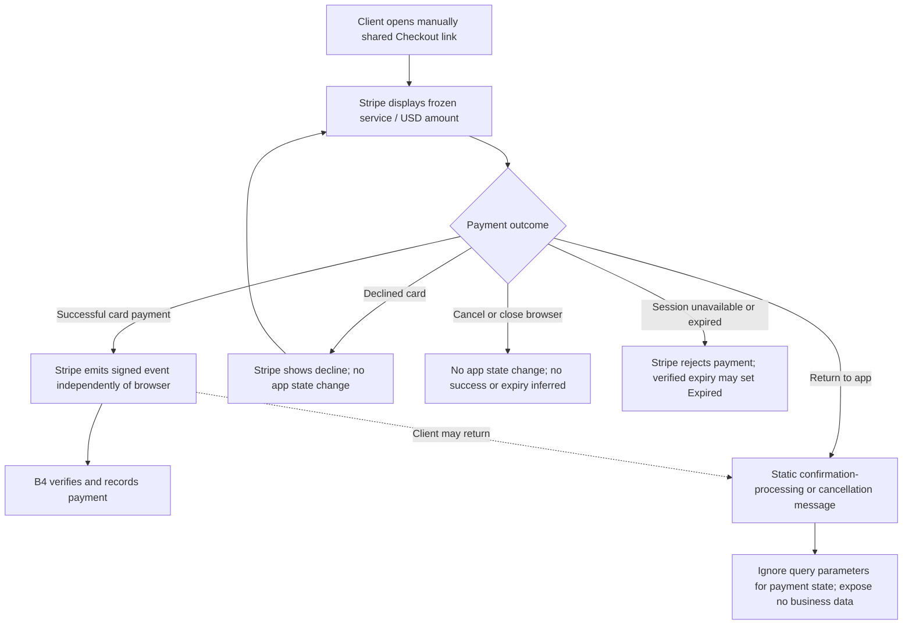

# B3 — Hosted payment and browser return

[Diagram index](README.md) | [Mermaid source](11-hosted-payment.mmd) | [SVG](rendered/11-hosted-payment.svg) | [PNG](rendered/11-hosted-payment.png) | [Full workflow context](../billing.md)

