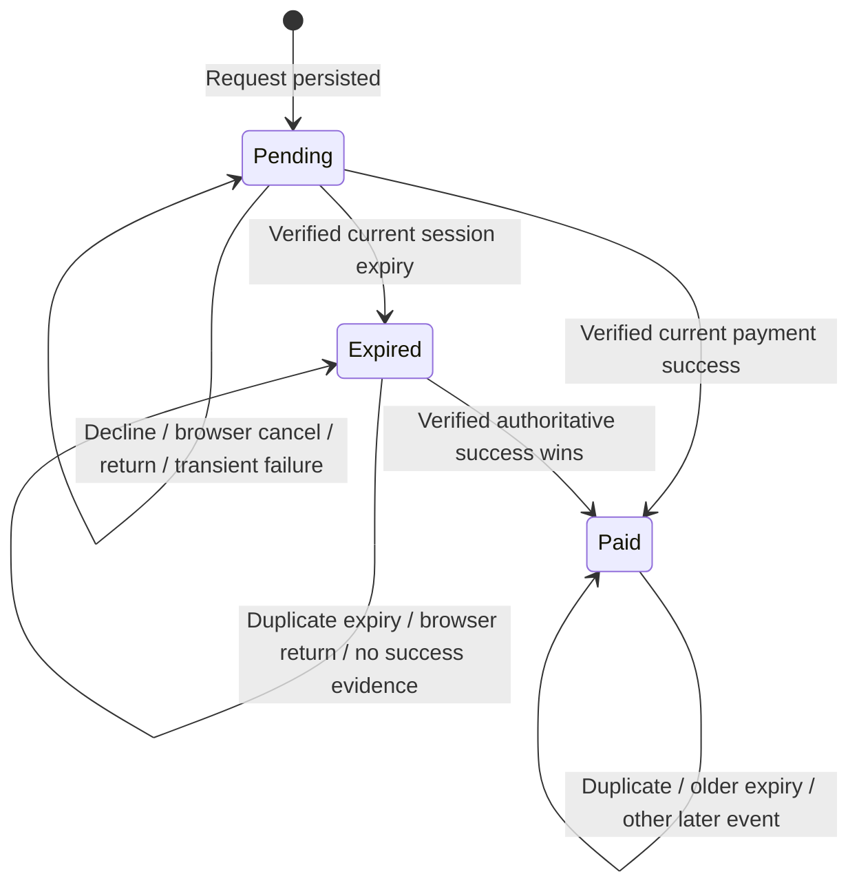

# B5 — Payment state machine

[Diagram index](README.md) | [Mermaid source](13-payment-states.mmd) | [SVG](rendered/13-payment-states.svg) | [PNG](rendered/13-payment-states.png) | [Full workflow context](../billing.md)

