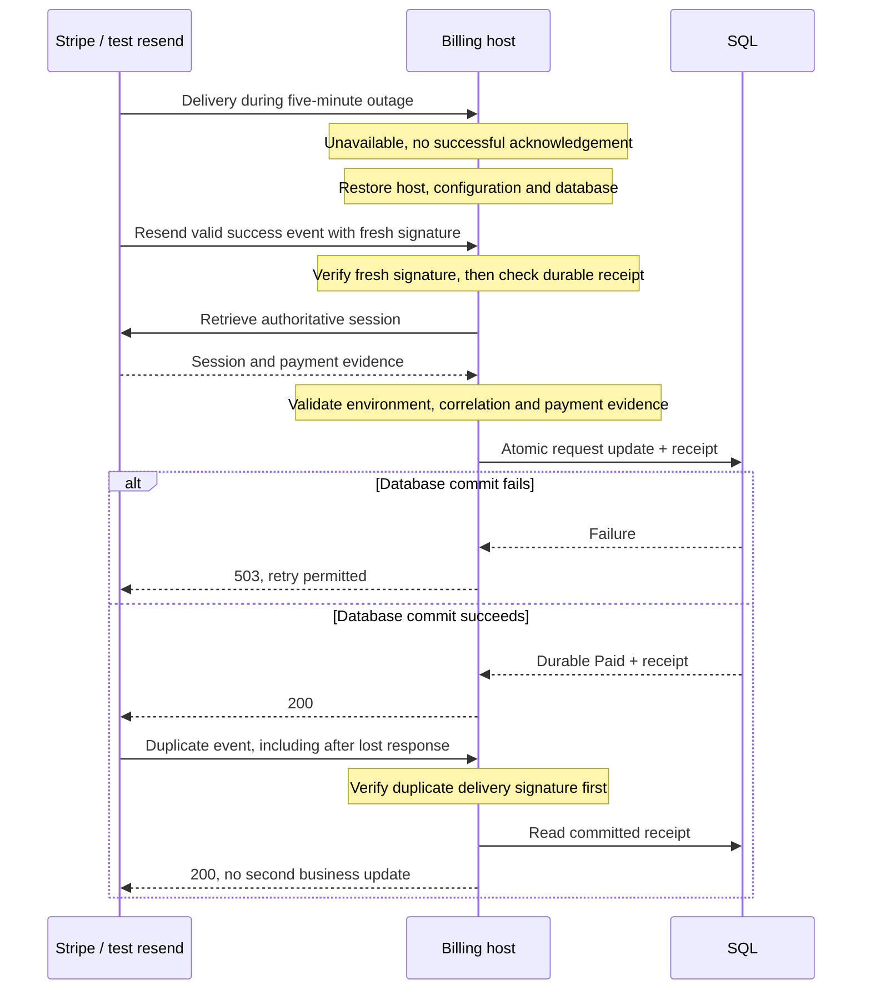

# B6 — Outage and acknowledgement recovery

[Diagram index](README.md) | [Mermaid source](14-outage-recovery.mmd) | [SVG](rendered/14-outage-recovery.svg) | [PNG](rendered/14-outage-recovery.png) | [Full workflow context](../billing.md)

