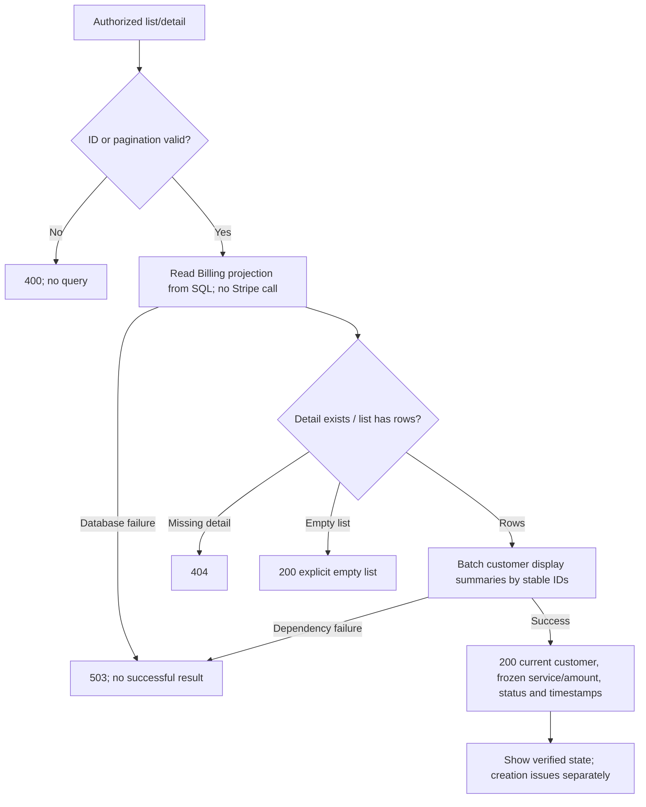

# B7 — Admin payment queries

[Diagram index](README.md) | [Mermaid source](15-payment-queries.mmd) | [SVG](rendered/15-payment-queries.svg) | [PNG](rendered/15-payment-queries.png) | [Full workflow context](../billing.md)

